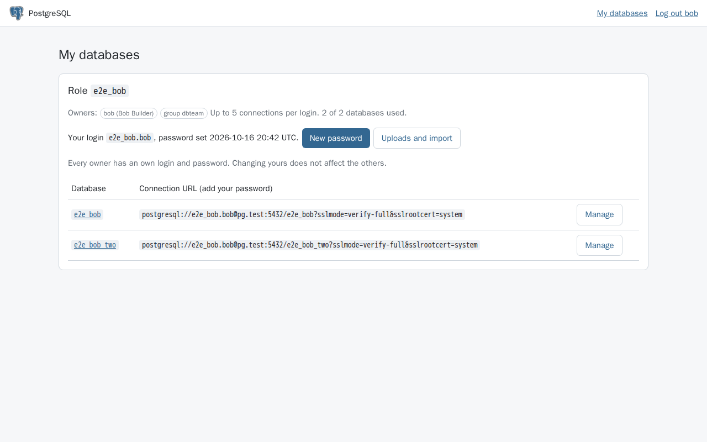

# PostgreSQL Server for Cloudron

A standalone PostgreSQL 18 server for clients outside of Cloudron, with a web panel to manage roles and databases.

* Connections are TLS 1.3 only, using the app domain's certificate
* Remote access is blocked until a network is added to the allowlist
* Each role only gets access to the databases it owns, every owner has an own login
* Sign in with Cloudron, admins manage roles, databases and allowed networks
* Snapshots, downloads and restores of databases, import of pg_dump archives

## Install

The app is listed in the community app store: https://ca.cloudron.io/app/io.cloudron.custom.postgresql

Changes per version are in the [releases](https://github.com/BrutalBirdie/PostgreSQL-Cloudron-App/releases).
